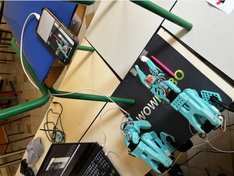
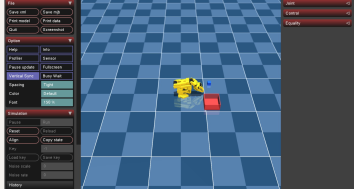
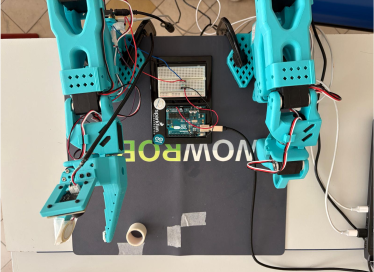
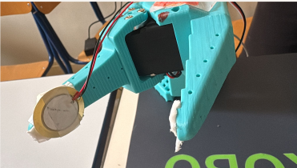
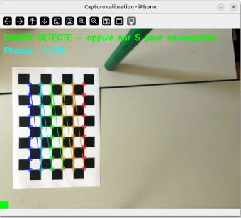
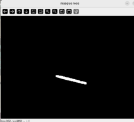
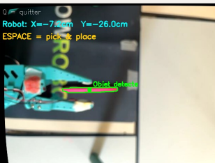

# SO-101 Learning Stack

**From imitation to autonomy on a low-cost 6-DOF arm: behavior cloning (ACT), a MuJoCo digital twin, adaptive-grip reinforcement learning, and an external-camera vision pipeline.**

This repository restructures the work carried out on the [SO-101](https://github.com/TheRobotStudio/SO-ARM100) robotic arm during the Hugging Face × AMD Robotics Hackathon 2025 and the follow-up project at Arts et Métiers (ENSAM). It brings five independent workstreams together under a single, reproducible structure, all built on top of the [LeRobot](https://github.com/huggingface/lerobot) ecosystem.

<p align="center">
  
</p>

---

## Overview

The arm is a 6-DOF leader/follower pair driven by Feetech STS3215 servos, controlled through LeRobot. Around it, five workstreams were explored:

1. **Imitation Learning (`il/`)** — record human teleoperation demonstrations, train an ACT (Action Chunking Transformer) policy, and run it autonomously for a pick-and-place task.
2. **Digital twin / sim-to-real (`sim/`)** — a MuJoCo model of the follower, driven in real time by the physical leader, used to prepare demonstrations without risking the real hardware.
3. **Adaptive-grip RL (`rl_grip/`)** — a tabular Q-learning loop that learns how tightly to close the gripper depending on the object, using tactile features from a piezoelectric sensor read by an Arduino.
4. **Vision (`vision/`)** — an external camera that locates an object on the table in centimeters in the robot frame, via intrinsic calibration, hand-eye calibration, and HSV color detection.
5. **Advanced RL (future work)** — SAC / HIL-SERL were studied conceptually but not implemented; see [Future work](#future-work).

---

## Repository structure

```
.
├── il/                 # Imitation Learning (ACT)
│   └── training-act.ipynb     # Colab training notebook (A100)
├── sim/                # MuJoCo digital twin
│   ├── teleop_mujoco.py       # real leader → virtual follower, 100 Hz
│   ├── act_mujoco.py          # run a trained ACT policy inside MuJoCo
│   ├── scene_pick_place.xml   # scene: arm + cube + bin
│   ├── scene.xml              # minimal scene
│   ├── so101_new_calib.xml/.urdf   # robot model (current)
│   ├── so101_old_calib.xml/.urdf   # robot model (older calibration)
│   ├── joints_properties.xml
│   └── assets/                # 13 STL meshes
├── rl_grip/            # Adaptive-grip reinforcement learning
│   ├── grip_rl_so101.py       # Q-learning session (two-phase grasp)
│   ├── grip_piezo_so101/      # Arduino sketch (piezo sensor)
│   └── README.md
├── vision/             # External-camera pick-and-place pipeline
│   ├── 1_capture.py           # capture chessboard photos
│   ├── 2_calibration.py       # intrinsic calibration → camera_params.npz
│   ├── 3_detection.py         # HSV detection → (x, y) in cm
│   ├── 4_handeye.py           # camera ↔ robot calibration → handeye_params.npz
│   └── 5_pipeline.py          # full detection → IK → servo command
├── legacy/             # First digital-twin attempt (Pinocchio + Rerun), abandoned
└── archive_unused/     # Outdated / broken scripts kept for reference
```

---

## Hardware & stack

- **Robot:** SO-101 follower + leader, Feetech STS3215 servos, USB camera
- **Sensor:** piezoelectric element on Arduino (Uno/Nano/Mega), wired on A0
- **OS:** Ubuntu 24.04
- **Framework:** LeRobot v0.4.4 (Python 3.11)
- **Simulation:** MuJoCo; Pinocchio + Rerun (legacy)
- **Vision:** OpenCV
- **Compute:** Google Colab Pro (A100) for training

> The ACT training was done with LeRobot v0.4.4 on Python 3.11 (Colab constraint). Moving to a custom policy (see Future work) would require LeRobot v0.5.x and Python 3.12.

---

## Installation

```bash
# Clone
git clone https://github.com/LPOUILLY28/PROJET_LeROBOT_SO101_ARM.git
cd PROJET_LeROBOT_SO101_ARM

# LeRobot is a dependency, installed in its own conda env
conda activate lerobot          # or create one and `pip install -e` a lerobot clone
pip install pyserial            # for the Arduino sensor (rl_grip)
```

Calibration files (`camera_params.npz`, `handeye_params.npz`, the leader/follower JSON in `~/.cache/huggingface/lerobot/...`) and recorded data are machine-specific and are **not** versioned — regenerate them with the scripts below.

---

## The five workstreams

### Imitation Learning (`il/`)

Record demonstrations, train ACT on Colab, then run the policy autonomously.

```bash
# 1. Record 50 teleoperated episodes
lerobot-record \
  --robot.type=so101_follower --robot.port=/dev/ttyACM0 --robot.id=my_follower_arm \
  --robot.cameras="{front:{type:opencv,index_or_path:/dev/video2,width:640,height:480,fps:15}}" \
  --teleop.type=so101_leader --teleop.port=/dev/ttyACM1 --teleop.id=my_leader_arm \
  --dataset.repo_id=LEO2862/so101_pick_place --dataset.num_episodes=50 \
  --dataset.single_task="Pick the blue object and place it in the bin"

# 2. Train ACT (open il/training-act.ipynb on Colab with an A100 GPU)

# 3. Run the trained policy autonomously
lerobot-record \
  --robot.type=so101_follower --robot.port=/dev/ttyACM0 --robot.id=my_follower_arm \
  --robot.cameras="{front:{type:opencv,index_or_path:/dev/video2,width:640,height:480,fps:15}}" \
  --dataset.repo_id=LEO2862/eval_act_pick_place --dataset.num_episodes=10 \
  --policy.path=LEO2862/act_so101_pick_place
```

### Digital twin (`sim/`)

The MuJoCo scene contains the arm, a blue cube (free joint, physics active) and a bin. The physical leader drives the virtual follower in real time.

<p align="center">
  
</p>

```bash
python sim/teleop_mujoco.py            # drive the virtual follower with the real leader
python sim/act_mujoco.py               # run a trained ACT policy in simulation
```

### Adaptive-grip RL (`rl_grip/`)

A piezoelectric sensor on the gripper feeds tactile features (peak voltage, gradient) to a Q-learning agent that learns the right closing force per object.

<p align="center">
  
  
</p>

Flash the Arduino sketch first, then:

```bash
python rl_grip/grip_rl_so101.py --simulate     # dry run, no hardware
python rl_grip/grip_rl_so101.py                # real session (200 trials, 4 objects)
```

See [`rl_grip/README.md`](rl_grip/README.md) for the full wiring and session protocol.

### Vision (`vision/`)

Intrinsic calibration with a chessboard, hand-eye calibration, then HSV detection that outputs the object position in centimeters in the robot frame.

<p align="center">
  
  
  
</p>

Run the scripts in order:

```bash
python vision/1_capture.py        # ~30 chessboard photos
python vision/2_calibration.py    # → camera_params.npz
python vision/4_handeye.py        # → handeye_params.npz
python vision/5_pipeline.py       # detect → inverse kinematics → grasp
```

---

## Results

- **Imitation Learning:** 50-episode dataset, ACT trained in ~1h30 for 100k steps on an A100. Dataset analysis reported a mean control delay of 3 steps (~100 ms) and a suggested chunk length of ~29 steps for this task.
- **Digital twin:** real-time MuJoCo teleoperation at 100 Hz with imperceptible latency (grouped `sync_read` + reader thread). The earlier Pinocchio + Rerun approach (in `legacy/`) only visualized the arm — no physics, no graspable objects — which is why it was dropped.
- **Adaptive-grip RL:** after only 20 trials, exploitation reached 100% and ε dropped from 1.0 to 0.54, with each object producing a distinct grip response. Known limitations: feature overlap between soft/rigid objects, `PIC_MAX_MV` miscalibrated (400 mV vs. 14–68 mV observed), and the piezo only senses contact dynamics, not sustained force.
- **Vision:** camera reprojection error < 1 px, robust HSV detection on a dark background, real-time (X, Y) readout in cm. Main limitation: hand-eye error of 5.67 cm (calibration poses too close together) and a fixed table height (planar only).

---

## Future work

- **Custom policy in the LeRobot ecosystem.** LeRobot v0.5+ supports third-party policies as installable `lerobot_policy_*` packages that plug into `lerobot-train`/`lerobot-eval` without forking the library. The plan is to implement a custom policy this way rather than relying solely on the built-in ACT.
- **Advanced RL.** SAC and HIL-SERL were studied during the project but not implemented; they are the natural next step beyond behavior cloning.
- **Sim-to-real.** Generate synthetic episodes in MuJoCo with domain randomization (masses, frictions, lighting) to pre-train policies before deploying on the real arm.
- **Vision upgrades.** Wider hand-eye pose spread to reduce the 5.67 cm error, and replacing HSV detection with a learned detector (e.g. YOLO) for arbitrary objects.

---

## Credits

Personal project on my own SO-101 arm, initiated and led by Léo Pouilly, developed with 5 Arts et Métiers classmates (team of 6).
Team (until May 2026): Anis Turki, Léo Pouilly, Stanislas Henon, Martin Saulnier, August Vanier, Alexandre Jeanne.

Built on [LeRobot](https://github.com/huggingface/lerobot) by Hugging Face.
